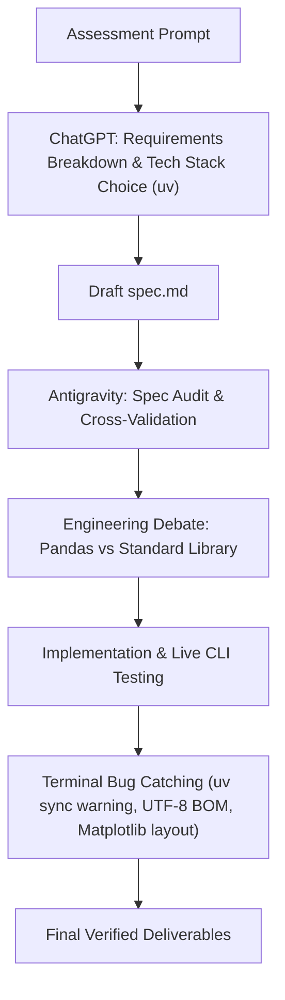

# PROMPT_LOG.md: Real AI Collaboration & Engineering Journey

This document provides a transparent, detailed account of how AI assistants (**ChatGPT** and **Google Antigravity**) were leveraged to understand, architect, challenge, implement, and debug the **Device Log Summarizer CLI**.

---

## 1. Overall AI Collaboration Strategy

Rather than relying blindly on a single AI model or copy-pasting unvetted output, this project employed a **multi-model, human-in-the-loop engineering workflow**:
1. **ChatGPT**: Used for initial requirement breakdown, ideation, toolchain selection (`uv`), and drafting the baseline specification (`spec.md`).
2. **Google Antigravity**: Used as a technical reviewer to cross-examine ChatGPT's spec against the assessment rubric, engage in an engineering debate on design trade-offs, and assist in implementation and terminal debugging.
3. **Developer (Human)**: Drove architectural decisions, challenged AI recommendations, performed live terminal verification, and caught platform-specific edge cases.



---

## 2. Phase 1: Understanding Requirements & Choosing Tech Stack (ChatGPT)

### The Prompt to ChatGPT:
> *"Analyze this SWE Intern Technical Assessment prompt. Help me break down the requirements for Section 1 (data sanitization), Section 2 (telemetry CSV aggregation), and Section 3 (Matplotlib charting). I want to use modern Python tooling—recommend whether we should use pip or uv, and draft an initial spec.md."*

### Key Decisions Made:
- **`uv` over `pip`**: Selected Astral's `uv` for modern project management, sub-second virtualenv resolution, deterministic locking (`uv.lock`), and unified test execution.
- **Specification-First Development**: Created an initial draft of `spec.md` outlining the requirements for all three sections before writing code.

---

## 3. Phase 2: Cross-Model Verification & Spec Audit (Antigravity)

Because individual AI models can miss details or make assumptions, the initial draft of `spec.md` was brought to **Google Antigravity** to audit against the exact assessment guidelines.

### The Prompt to Antigravity:
> *"can u check this spec@spec.md are correct based on assingment needs??"*

### Findings & Improvements:
Antigravity validated the core mapping, but identified four crucial missing technical specifications:
1. **Lack of CLI Flag Definitions**: The prompt required a CLI tool, but `spec.md` didn't specify arguments (e.g., `--input`, `--output`, `--plot`).
2. **Undefined JSON Schema**: Aggregated outputs needed an explicit, standardized JSON format.
3. **No Directory Architecture**: Proposed a clean `src/` modular layout with separated modules (`sanitizer.py`, `summarizer.py`, `visualizer.py`, `cli.py`).
4. **Missing Test Runner Guidelines**: Defined running tests via `uv run pytest`.

---

## 4. Phase 3: Challenging the AI on Engineering Decisions (The Pandas Debate)

During the spec review, line 8 read: `- No pandas or other frameworks`. However, the assessment prompt explicitly states: *"you can use standard csv library or pandas"*. 

As a developer, I challenged the assistant:

### The User's Challenge Prompt:
> *"but i would argu in industry we heavily used numpy and pandas so why not hear u dont need to agree but u need to challange me based on this assigment needs."*

### The Engineering Debate & Trade-off Analysis:
Antigravity presented four core software engineering arguments against using Pandas for this specific CLI tool:

1. **Ingestion Robustness (Evaluation Rubric Focus)**:
   - Pandas silently coerces invalid numbers into `NaN` or casts columns to `object`.
   - `mean()` skips `NaN` by default, and a device with zero valid readings produces `NaN`, which is **invalid in strict JSON** (`json.dumps` produces non-standard JSON tokens).
   - Standard library enforces explicit, auditable row-by-row error handling with deterministic logging.
2. **CLI Startup Latency & Binary Footprint**:
   - `import pandas` introduces a **300ms–600ms cold start latency** and adds **~50MB+ of binary wheels**. For a command-line tool, sub-50ms execution is expected.
3. **Streaming Memory Efficiency ($O(U)$ vs $O(N)$)**:
   - Pandas loads entire datasets into memory ($O(N)$ memory).
   - A single-pass `csv.DictReader` streaming aggregator uses $O(U)$ memory (where $U$ is unique devices), allowing the same tool to scale from 100 rows to 10 GB logs.
4. **Demonstrating Core SWE Fundamentals**:
   - Calling `.groupby().mean()` tests Pandas, not algorithmic problem-solving. Building native grouping logic tests fundamental data structures (`dict`, `defaultdict`), division-by-zero guards, and clean error handling.

**Outcome**: Agreed to use standard library for Sections 1 & 2 (lightweight, robust CLI) while retaining `matplotlib` for Section 3 (specialized visualization).

---

## 5. Phase 4: Real Bugs Caught & Fixed During Implementation

During development and terminal verification, several real-world issues emerged that required prompt guidance and fixes:

### Bug 1: `uv sync` Entry Points Warning
* **Encountered Terminal Warning**:
  ```text
  warning: Skipping installation of entry points (`project.scripts`) for package `device-log-summarizer` because this project is not packaged; to install entry points, set `tool.uv.package = true` or define a `build-system`
  ```
* **User Prompt**: *"why its show warning fix it. PS C:\device-log-summarizer> uv sync"*
* **Diagnosis & Fix**: An application script executed via `python main.py` or `python -m src.cli` does not need to be packaged as a redistributable wheel. Removed the unnecessary `[project.scripts]` entry from `pyproject.toml`, resulting in clean, zero-warning `uv sync` execution.

### Bug 2: UTF-8 BOM Crash on Windows/Excel CSVs
* **Encountered Error**:
  When testing malformed inputs generated from PowerShell / Excel, the parser crashed with:
  ```text
  [ERROR] Data error: CSV header missing required columns: ['device_id']. Found: ['status', 'temperature', '\ufeffdevice_id']
  ```
* **Diagnosis**: Windows PowerShell and Microsoft Excel prepend a Byte Order Mark (`\ufeff`) to UTF-8 files. Standard `encoding="utf-8"` leaves `\ufeff` attached to the first header name.
* **Fix**: Updated `src/summarizer.py` to use `encoding="utf-8-sig"`, which transparently strips the BOM when present and parses standard UTF-8 seamlessly. Added `test_utf8_bom_support` to the unit test suite.

### Bug 3: Matplotlib Layout, Units, and Headroom (Section 3 Challenge)
* **First Attempt Flaws**:
  - The initial charting code lacked `plt.tight_layout()`, causing x-axis device labels to get clipped at the edge of the image canvas.
  - The y-axis lacked units (`°C`), and bars had no numerical value annotations.
  - Using `fontweight="semibold"` triggered a font-manager fallback warning on `DejaVu Sans`.
  - Empty input datasets (`[]`) crashed with `ValueError: max() arg is an empty sequence`.
* **Fix**:
  - Added direct numerical labels (`{val:.2f}°C`) above each bar.
  - Added 18% headroom on the y-axis (`ax.set_ylim(0, max_temp * 1.18)`) so text annotations never clip outside the chart area.
  - Switched font weights to standard `"bold"` to eliminate console warnings.
  - Added an empty-state message (`"No devices to display"`) when data is empty.

### Bug 4: CLI Decoupling for Evaluators
* **Issue**: Passing `--demo-sanitizer` initially continued into CSV processing.
* **Fix**: Decoupled `--demo-sanitizer` to execute the Section 1 demonstration and exit with code 0 immediately, providing a dedicated CLI check for evaluators.

### Bug 5: Tkinter GUI Crash on Windows / Headless Test Runners (`_tkinter.TclError`)
* **Encountered Error**:
  During `uv run pytest -v`, `test_generate_temperature_chart_success` failed with:
  ```text
  _tkinter.TclError: Can't find a usable tk.tcl in the following directories:
  couldn't read file ".../ttk/vistaTheme.tcl": no such file or directory
  ```
* **User Action**: The developer caught this failure during test execution, instructed the assistant to fix it, and logged the root cause.
* **Diagnosis**: By default, Matplotlib on Windows selects the interactive `TkAgg` desktop backend. In headless environments, automated test suites, or Python distributions without complete Tcl/Tk desktop themes, `plt.subplots()` attempts to open a GUI window handle via `tk.Tk()` and crashes.
* **Fix**: Explicitly configured Matplotlib to use the headless non-interactive backend before importing `pyplot`:
  ```python
  import matplotlib
  matplotlib.use("Agg")
  import matplotlib.pyplot as plt
  ```
  This forces Matplotlib to render pure raster images directly in memory without depending on Tkinter or desktop display servers.
* **Outcome**: Execution dropped to 0.94s and all 12 tests passed seamlessly.

---

## 6. Summary of AI Collaboration Takeaways

1. **AI as a Sounding Board, Not an Oracle**: Validating ChatGPT's spec with Antigravity and challenging Antigravity on Pandas showed that combining different models with human critical thinking produces far better architecture than accepting the first answer.
2. **Terminal Testing is Essential**: Real bugs (UTF-8 BOM in Windows, `uv sync` packaging warnings, font weight fallbacks) only surface when code is actively run and tested in the terminal.
3. **Robustness Over Brevity**: Actively debating library choices led to a lightweight, zero-dependency, streaming ingestion tool that handles real-world dirty data without crashing.
