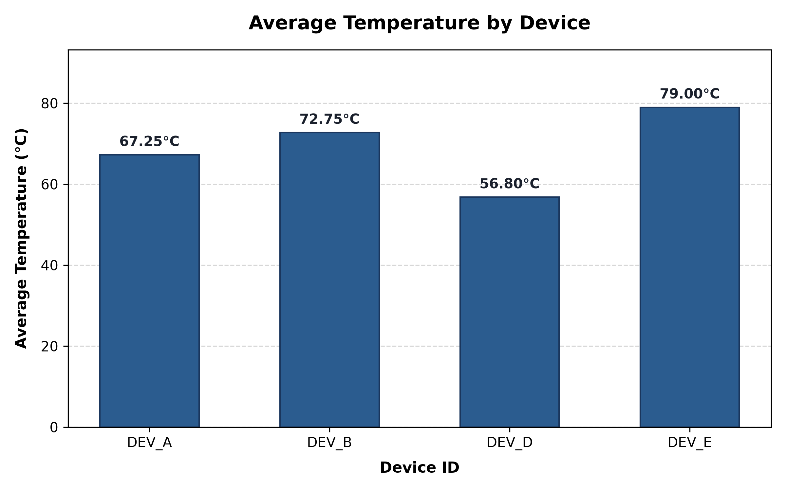

# Device Log Summarizer CLI

A robust, lightweight command-line interface (CLI) tool designed to sanitize raw sensor telemetry, aggregate device operational logs from CSV data, filter metrics based on safety thresholds, and export results into structured JSON and Matplotlib visual comparisons.

---

## Architecture & Project Structure

```text
device-log-summarizer/
├── src/
│   ├── __init__.py
│   ├── sanitizer.py       # Section 1: clean_sensor_readings
│   ├── summarizer.py      # Section 2: CSV streaming ingest, aggregation, and JSON export
│   ├── visualizer.py      # Section 3: Matplotlib chart generation
│   └── cli.py             # Unified CLI entry point (argparse)
├── tests/
│   ├── __init__.py
│   ├── test_sanitizer.py  # Unit tests for Section 1 sanitization
│   ├── test_summarizer.py # Unit tests for Section 2 aggregation & export
│   └── test_visualizer.py # Unit tests for Section 3 charting & error handling
├── device_telemetry.csv   # Sample device telemetry dataset
├── summary.json           # Sample generated JSON output
├── temperature_chart.png  # Generated temperature comparison bar chart
├── PROMPT_LOG.md          # Log of AI collaboration & bug fixes (Section 3)
├── README.md              # Documentation and usage guide
├── pyproject.toml         # uv project configuration and dependencies
└── spec.md                # Technical requirements specification
```

---

## Architectural Decisions: Standard Library vs. Pandas

While frameworks like `pandas` are standard in offline data science workflows, this project deliberately utilizes the **Python standard library** (`csv`, `collections`, `statistics`, `json`) for the data ingestion engine:

1. **Sub-50ms CLI Startup**: Eliminates the 300–600ms import overhead of heavy C-extensions (NumPy/Pandas) for instant CLI responsiveness.
2. **Streaming Memory Efficiency ($O(U)$ vs. $O(N)$)**: Processes records row-by-row in a single pass. Memory complexity scales only with the number of unique devices ($U$), rather than loading millions of records ($N$) into memory.
3. **Explicit Validation & Robustness**: Avoids silent type coercions and NaN quirks (which break strict JSON specifications). Malformed rows are logged and skipped deterministically without crashing.

---

## Requirements & Setup

### Using `uv` (Recommended)
This project uses [`uv`](https://github.com/astral-sh/uv) for fast, reproducible environment management:

```bash
# Clone or extract the repository
cd device-log-summarizer

# Install dependencies (matplotlib, pytest)
uv sync
```

### Using Standard `pip` (Alternative)
```bash
python -m venv .venv
# On Windows:
.venv\Scripts\activate
# On macOS/Linux:
source .venv/bin/activate

pip install matplotlib pytest
```

---

## Usage

### 1. Run the Full Summarizer Pipeline
Ingests `device_telemetry.csv`, displays the terminal summary table, writes `summary.json`, and generates `temperature_chart.png`:

```bash
uv run python main.py
# or
uv run python -m src.cli
```

### 2. Custom Options (Custom Threshold and File Names)
You can customize the input file, output file paths, and temperature threshold (e.g. filtering at 75.0°C instead of 80.0°C):

```bash
uv run python -m src.cli --input device_telemetry.csv --output custom_summary.json --threshold 75.0 --plot custom_chart.png
```

| Flag | Shorthand | Default | Description |
|---|---|---|---|
| `--input` | `-i` | `device_telemetry.csv` | Path to telemetry CSV log |
| `--output` | `-o` | `summary.json` | Path to export aggregated JSON |
| `--plot` | `-p` | `temperature_chart.png` | Path to save the Matplotlib chart |
| `--threshold` | | `80.0` | Maximum allowable average temperature (°C) |
| `--skip-plot` | | `False` | Skip chart generation (JSON export only) |
| `--demo-sanitizer` | | `False` | Run demonstration of Section 1 data cleaner |
| `-v`, `--verbose` | | `False` | Enable debug logging |

### 3. Run Section 1 Sanitizer Demo
Demonstrates the sensor cleaning and clipping algorithm on raw, noisy inputs:
```bash
uv run python -m src.cli --demo-sanitizer
```

---

## Sample Output

### Terminal Execution & Summary Table


*(Notice `DEV_C` with an average temperature of 87.50°C was safely filtered out).*

### Generated `summary.json`
```json
[
  {
    "device_id": "DEV_A",
    "total_records": 4,
    "average_temperature": 67.25,
    "error_count": 0
  },
  {
    "device_id": "DEV_B",
    "total_records": 4,
    "average_temperature": 72.75,
    "error_count": 2
  },
  {
    "device_id": "DEV_D",
    "total_records": 3,
    "average_temperature": 56.8,
    "error_count": 0
  },
  {
    "device_id": "DEV_E",
    "total_records": 4,
    "average_temperature": 79.0,
    "error_count": 1
  }
]
```

### Generated Visualization
The tool generates `temperature_chart.png` with clean value annotations, high DPI, and automatic margin adjustment:



---

## Running Automated Tests

Run the full test suite (12 unit tests across all sections):

```bash
uv run pytest -v
```

Or using standard library `unittest`:
```bash
python -m unittest discover tests
```

---

## AI Collaboration Log

Details on the prompt engineering workflow, the flaw in the AI's initial charting script, and the corrective follow-up prompt can be found in [`PROMPT_LOG.md`](file:///c:/device-log-summarizer/PROMPT_LOG.md).
